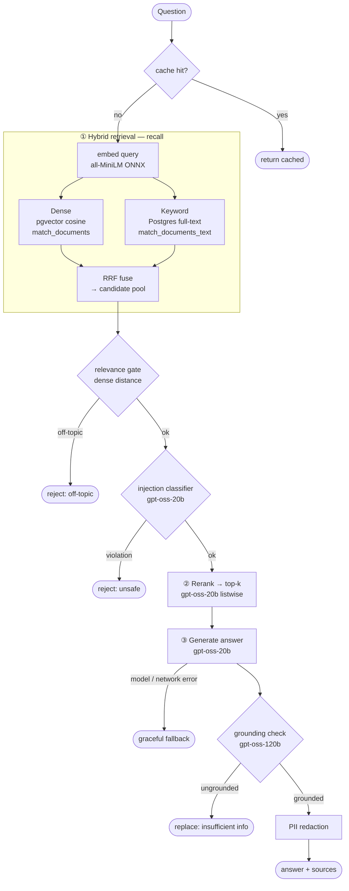

# Frost Arena RAG

A production-grade retrieval-augmented generation service that answers questions
about a venue ("The Frost Arena") using only a trusted knowledge base. Built to
demonstrate the full lifecycle of an LLM feature — not just working, but
**retrieved well, evaluated, observable, guarded, and deployed.**

## Live demo

- **Live:** https://frost-arena-rag.onrender.com
- **Interactive API docs:** https://frost-arena-rag.onrender.com/docs
- **Ask a question:** https://frost-arena-rag.onrender.com/ask?q=when is happy hour

> Hosted on Render's free tier, which sleeps when idle, so the first request
> after a pause takes ~30–60s to wake and load the embedding model. Subsequent
> requests are fast.

## Architecture



## How it works

### Retrieval — hybrid, then reranked

Retrieval is two stages: a wide net for **recall**, then a precise reorder for
**precision**.

1. **Hybrid search** runs two retrievers inside one Postgres and fuses them:
   - **Dense** (`match_documents`): pgvector cosine search over
     `all-MiniLM-L6-v2` embeddings — captures meaning.
   - **Keyword** (`match_documents_text`): Postgres full-text search (a
     GIN-indexed `tsvector` column, OR-of-lexemes query, `ts_rank`) — captures
     exact tokens the embedding blurs, like IDs and codes.
   - **Reciprocal Rank Fusion** merges the two ranked lists on rank
     (`Σ 1/(60 + rank)`), so no score normalisation is needed between cosine
     distance and `ts_rank`.
2. **Reranking** (`gpt-oss-20b`, listwise) reorders the fused candidate pool so
   the best passages reach the top — a cross-encoder-style precision pass the
   bi-encoders can't do alone.

Full design, measurements, and the dense → hybrid → reranked progression are in
[`HYBRID_RETRIEVAL.md`](./HYBRID_RETRIEVAL.md).

### Generation

`gpt-oss-20b` via Groq's OpenAI-compatible API, prompted to answer **only** from
the retrieved context and to say when it doesn't know.

### Guardrails

Two on the way in, three on the way out:

- **Input — relevance gate:** off-topic questions are rejected on dense distance
  _before_ any model call (cheaper and safer than letting the LLM field them).
- **Input — injection classifier** (`gpt-oss-20b`): screens for prompt-injection
  / jailbreak attempts that pass the relevance gate. Fails open.
- **Output — graceful fallback:** a model/network error returns a safe message
  (HTTP 200), never a stack trace.
- **Output — grounding check** (`gpt-oss-120b`): confirms every claim is
  supported by the context; replaces the answer if not. Fails open.
- **Output — PII redaction:** scrubs emails and UK phone numbers from the answer
  and from what is logged.

### Observability

Every request is traced in Langfuse — prompt, response, latency, tokens, and
cost — with each stage (`retrieve`, `rerank`, each guardrail, `generate`) nested
under one parent span. See [`OBSERVABILITY.md`](./OBSERVABILITY.md).

### Evaluation

- A re-runnable **Promptfoo** suite runs as a **blocking CI gate** on every push
  and PR — the build fails if any case fails or errors.
  See [`EVAL_README.md`](./EVAL_README.md).
- A **retrieval-quality harness** (`retrieval_eval.py`) reports hit-rate@k and
  MRR over EASY (semantic) and HARD (opaque-ID) query groups, used to measure
  every retrieval change before trusting it.

## Results

| Retrieval stage | Overall MRR | hit-rate@5 |
| --------------- | ----------- | ---------- |
| Dense only      | 0.68        | 71%        |
| + Hybrid (RRF)  | 0.75        | 81%        |
| + Reranking     | **0.85**    | **90%**    |

- Reranking drove hard exact-ID cases to effectively perfect and lifted overall
  retrieval to its **recall ceiling** — every document the retriever could reach
  reached the top 5.
- **Model choice was measured, not assumed:** the reranker runs on `gpt-oss-20b`,
  which matched `gpt-oss-120b` on overall quality at ~3× lower latency.
- Tracing showed **generation and reranking dominate latency**; retrieval is
  negligible. The guardrail stack is a deliberate, measured safety/cost trade-off.

## Stack

- **API:** FastAPI (`/ask`, `/search`, `/embed`, `/ingest`), with per-IP rate
  limiting, optional read API key, and a separate always-keyed ingest endpoint.
- **Vector + keyword store:** Supabase (Postgres with pgvector + full-text). An
  in-memory Chroma collection is the local/CI fallback when Supabase isn't
  configured.
- **Embeddings:** `all-MiniLM-L6-v2`, Chroma's ONNX build (no torch — keeps the
  service under Render's 512MB free-tier limit).
- **LLM:** Groq — `gpt-oss-20b` (generation, injection classifier, reranker),
  `gpt-oss-120b` (grounding check).
- **Observability:** Langfuse.

## API

| Method | Path            | Purpose                                                              |
| ------ | --------------- | -------------------------------------------------------------------- |
| GET    | `/ask?q=&k=`    | Full RAG pipeline: retrieve → rerank → guardrails → answer + sources |
| GET    | `/search?q=&k=` | Retrieval only (hybrid + rerank), for eval/debugging                 |
| GET    | `/embed?q=`     | Embedding vector for a string                                        |
| POST   | `/ingest`       | Add/replace a document (keyed; Supabase backend only)                |

## Running locally

```bash
python -m venv .venv && source .venv/bin/activate   # Windows: .venv\Scripts\Activate.ps1
pip install -r requirements.txt
uvicorn main:app --reload
```

Provide these as environment variables (locally in a git-ignored `.env`; in
production as the host's secrets):

```bash
GROQ_API_KEY=...
# Supabase backend (omit to use the in-memory Chroma fallback):
SUPABASE_URL=...
SUPABASE_SECRET_KEY=...
# Observability (omit to run without tracing):
LANGFUSE_PUBLIC_KEY=...
LANGFUSE_SECRET_KEY=...
LANGFUSE_HOST=https://cloud.langfuse.com
```

Load the knowledge base into Supabase (and re-run any time `kb.py` changes):

```bash
python migrate_to_supabase.py
```

## Deployment

Runs as a Python web service on Render's free tier:

- Uses Chroma's ONNX embedder (not the torch SentenceTransformer) to stay under
  the 512MB free-tier memory limit.
- Secrets are set as Render environment variables, never committed.
- Start command: `uvicorn main:app --host 0.0.0.0 --port $PORT`.

> **Note:** the response cache is in-process and single-instance — it is cleared
> on redeploy and not shared across replicas. A multi-instance deployment would
> back it with a shared store (e.g. Redis).

## Further reading

- [`HYBRID_RETRIEVAL.md`](./HYBRID_RETRIEVAL.md) — hybrid search + reranking:
  design, the hostile-corpus method, and the full before/after numbers.
- [`OBSERVABILITY.md`](./OBSERVABILITY.md) — Langfuse tracing and what the
  dashboard revealed.
- [`EVAL_README.md`](./EVAL_README.md) — the eval suite, metric strategy, and CI
  gate.
